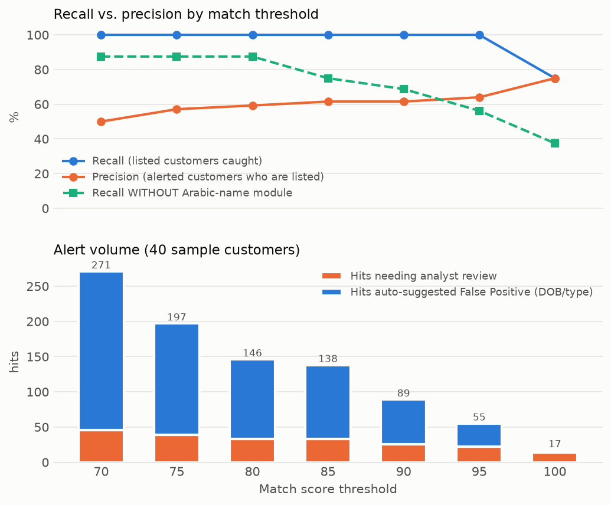

# OFAC Sanctions Screening Engine (with Arabic-name intelligence)

A working name-screening engine that checks customers against the **real U.S. Treasury OFAC SDN list** (plus aliases and the Consolidated non-SDN list). It scores each potential match from 0 to 100, lists the reasons for the score, and suggests a disposition (**True Match / Potential Match – escalate / False Positive**), the same three outcomes a Level 1 OFAC analyst works with.

The differentiator is a dedicated **Arabic-name module**. It recognises that *Moammar el-Gaddafi*, *Muammar QADHAFI*, *Kadhafi* and *معمر القذافي* are the same name. It also stops common names such as *Mohamed Ali Hassan* from swamping the alert queue.

> All customer data is fictional. List data is the public OFAC download. This is a portfolio and teaching tool, not a production compliance system.

---

## Why this matters for OFAC compliance

* **OFAC sanctions are strict liability.** A U.S. person who processes a payment for a Specially Designated National (SDN) can be penalised even without knowing. Screening is the main control that prevents this.
* **Names are the weak point.** The SDN list holds about 19,500 entries and 20,000 aliases. Many are Arabic, Persian or Russian names transliterated inconsistently. Exact matching misses true hits. Loose fuzzy matching buries analysts in false positives.
* **Examiners ask why.** A screening program has to show its logic: why an alert fired, and why it was cleared. Every hit here carries a plain-English reasons list and a score breakdown, which is what a QA reviewer or examiner would ask for.

## What it does

| Capability | Detail |
|---|---|
| Real list data | `sdn.csv`, `alt.csv` (aliases), `add.csv` (addresses) and the Consolidated non-SDN list (`cons_*.csv`), downloaded from treasury.gov into `data/`. Coverage: 20,049 entries and 41,396 searchable names. |
| Normalisation | Accents, punctuation, `LAST, First` reordering, legal forms (LLC, FZE, S.A.) and generic business words removed. |
| **Arabic-name module** | Transliteration variants (Mohammed/Muhammad/Mohamed/Mohamad, Hussein/Husain/Hossein, Qaddafi/Gaddafi/Kadhafi, Yusuf/Youssef and the cognate Joseph, plus about 90 more). Compounds (Abdul/Abd al-/Abdel/Abdur + name, Salah ad-Din, Abu Bakr). Particles (al-/el-/ash-, bin/ibn/ben/bint/ould). Honorifics stripped (Sheikh, Sayyid, Haji, Dr., الشيخ …). **Arabic-script input** is transliterated. A consonant-skeleton phonetic key catches unseen spellings. |
| Fuzzy scoring | rapidfuzz **token-sort ratio**, **Jaro-Winkler**, word-by-word alignment and phonetic-skeleton similarity, blended into a 0–100 score. A subset rule handles names where one side has extra middle names. |
| Secondary identifiers | DOB (exact / year / conflict), nationality and entity-type checks drive the suggested disposition. |
| 50% Rule | For a company, list its owners (`Name|pct;…`). If owners who match the list together hold 50% or more, the company is flagged as blocked even though it is not named on the list. |
| Interfaces | CLI (`screen.py`) and a Streamlit web app (`app.py`). |
| Tuning analysis | Threshold vs recall vs alert volume, plus a comparison run **without** the Arabic module. |

## Quick start

```bash
cd 01-sanctions-screening
python3 -m venv .venv && source .venv/bin/activate
pip install -r requirements.txt
python screen.py update-lists          # refresh OFAC files (already included in data/)
```

**Screen one name**

```bash
python screen.py name "Sheikh Moammar el-Gaddafi" --dob 1942 --nationality Libya
python screen.py name "معمر القذافي"
python screen.py name "Levant Horizon Trading FZE" --type entity --owners "Rami Makhluf|35;Iyad Makhlouf|20;Karim Haddad|45"
python screen.py name "Ali Hassan" --dob 1979-11-03 --json
```

**Screen a customer file and run the tuning analysis**

```bash
python screen.py batch sample_data/customers.csv --out output
python screen.py tune  sample_data/customers.csv --out output
```

**Web UI**

```bash
streamlit run app.py
```

The sidebar sets the threshold and list scope. The first tab screens a single name and shows expandable hit cards. The second tab batch-screens a CSV (or the built-in sample) and offers the results as a download.

## Sample output

```
Query       : Sheikh Moammar el-Gaddafi
Normalised  : muammar qadhafi
              - Removed title/honorific: sheikh
              - Ignored name particles: el
              - 'moammar' treated as transliteration variant of 'muammar'
              - 'gaddafi' treated as transliteration variant of 'qadhafi'
Result      : True Match

[1] score 100.0  True Match
    List entry : QADHAFI, Muammar  (SDN SDN-12606, individual)
    Matched on : primary name -> QADHAFI, Muammar
    Programs   : LIBYA2
    DOB        : 1942
    Why        : Strong name match, birth year and nationality consistent - block/reject and report
      * DOB year match only (1942; list: 1942) - obtain full DOB / ID document
      * Nationality/country consistent (Libya)

[2] score  95.0  False Positive
    List entry : GADDAFI, Hannibal  (SDN SDN-12627, individual)
    Why        : Name similar but date of birth does not match the list entry
      * DOB conflict: customer 1942 vs list 20 Sep 1975; 1977
```

A common name: the alerts are real, and the secondary identifiers clear them.

```
Query  : Ali Hassan   (DOB 1979-11-03, Jordan)
[1] 100  False Positive  FADHIL, Mustafa Mohamed  via alias 'ALI, Hassan'   DOB conflict: 1979 vs 23 Jun 1976
[2]  95  False Positive  KHALIL, Ali Hassan                                 DOB conflict: 1979 vs 15 Jul 1964
...
```

The full outputs are in [`output/`](output/): the [batch report](output/screening_report.md), [results CSV](output/screening_results.csv), [detailed JSON](output/screening_results.json) and the `example_*.txt` single-name runs.

### Batch results on the 40-customer sample (threshold 85)

| Disposition | Customers | Who |
|---|---|---|
| True Match | 14 | Listed persons and entities submitted under variant spellings (Gaddafi, Nasrullah, Suleimani, Abu Marzouk, Arabic script, Bank Melli, Mahan Air…) |
| Potential Match – escalate | 6 | Arabic-script Bin Laden with no DOB, a company 55% owned by SDNs (50% Rule), a restaurant named after a listed person, common names where the DOB could not resolve the alert |
| False Positive | 6 | Common Arabic names whose DOB or entity type rules out the list entry |
| No Match | 14 | Clean customers, including Arabic names with no listed counterpart |

All 16 customers built to be caught (`expected = sdn`) were alerted.

## False-positive tuning analysis

`python screen.py tune` re-runs the sample at thresholds 70–100. The `expected` column in `customers.csv` is a label used only for this evaluation; the engine never reads it.



| Threshold | Recall | Customers alerted | Hits | Auto-suggested FP | Hits left for analyst | Recall **without** Arabic module |
|---|---|---|---|---|---|---|
| 70 | 100% | 32 | 271 | 225 | 46 | 88% |
| 80 | 100% | 27 | 146 | 113 | 33 | 88% |
| **85** (default) | **100%** | 26 | 138 | 105 | **33** | **75%** |
| 90 | 100% | 26 | 89 | 63 | 26 | 69% |
| 95 | 100% | 25 | 55 | 33 | 22 | 56% |
| 100 | 75% | 16 | 17 | 3 | 14 | 38% |

**What this shows**

1. **The Arabic module is what makes high recall possible.** With the same fuzzy scorer and the module switched off, recall at 85 drops to 75%. Two Arabic-script customers become unmatchable, and *Gaddafi → QADHAFI* and *Saif el-Islam Gadhafi* fall just below the line (84–85).
2. **Threshold mainly controls workload.** Going from 70 to 85 halves the hit count (271 → 138) on this sample without losing a true match. Going to 100 loses a quarter of the true matches: anyone whose name is not identical after normalisation.
3. **Secondary identifiers do most of the false-positive work.** About three-quarters of hits at 85 are auto-suggested False Positive because the DOB or entity type conflicts. That is why collecting a full DOB at onboarding matters more than tightening the threshold.
4. **The trade-off is real.** Collapsing *Mohamed/Muhammad/Mohammed* into one form also raises alert volume on common names (271 hits with the module vs 165 without at 70). The sample is small and deliberately hard (16 of 40 customers are listed persons, far more than in a real book). A production threshold would be set on a larger, representative below-the-line sample and documented in the bank's model-validation file.

## Project layout

```
01-sanctions-screening/
├── screen.py                  CLI (name | batch | tune | update-lists)
├── app.py                     Streamlit UI
├── sanctions_screener/
│   ├── arabic.py              Arabic-name rules, variant table, script transliteration, phonetic skeleton
│   ├── normalize.py           generic normalisation (applied identically to customer + list names)
│   ├── loader.py              parses OFAC CSVs and remarks (DOB, POB, nationality), builds cached index
│   ├── matcher.py             candidate search, scoring, explanations, dispositions, 50% Rule
│   ├── batch.py               batch screening, CSV/JSON/Markdown reports, threshold tuning
│   ├── plot.py                tuning chart
│   └── download.py            fetches the latest lists from treasury.gov
├── data/                      OFAC source files (SDN, alt, add, consolidated)
├── sample_data/customers.csv  40 fictional customers incl. near-misses of real SDN entries
├── output/                    example results, report, tuning table and chart
├── HOW_IT_WORKS.md            one-page interview prep sheet
└── requirements.txt
```

## Limitations (and what a production system adds)

* Screens names only. Production systems also screen addresses, vessel IMO numbers, BICs, ID numbers and payment free-text (e.g. SWIFT MT103 field 70), and screen sanctioned *jurisdictions* (Cuba, Iran, North Korea, Syria, Crimea/DNR/LNR).
* The 50% Rule check needs the ownership data supplied. In practice it comes from KYC/UBO collection and corporate registries.
* The disposition is a **suggestion**. Only an analyst confirms a true match, and the decision and evidence are documented.
* The variant table and phonetic key are tuned for Arabic. Persian, Russian/Cyrillic and Chinese names would need their own modules.
* No list-change ("delta") screening of the existing customer base. A production system re-screens all customers whenever OFAC updates the list.

## Data source

U.S. Department of the Treasury, Office of Foreign Assets Control: [SDN List](https://ofac.treasury.gov/specially-designated-nationals-and-blocked-persons-list-sdn-human-readable-lists) and [Consolidated Sanctions List](https://ofac.treasury.gov/consolidated-sanctions-list-non-sdn-lists), downloaded November 2026 (public domain).
