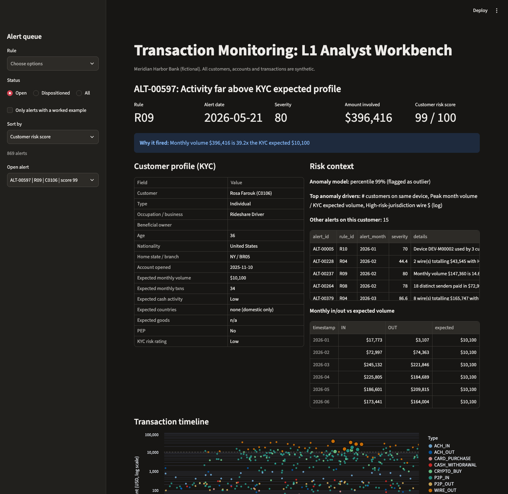
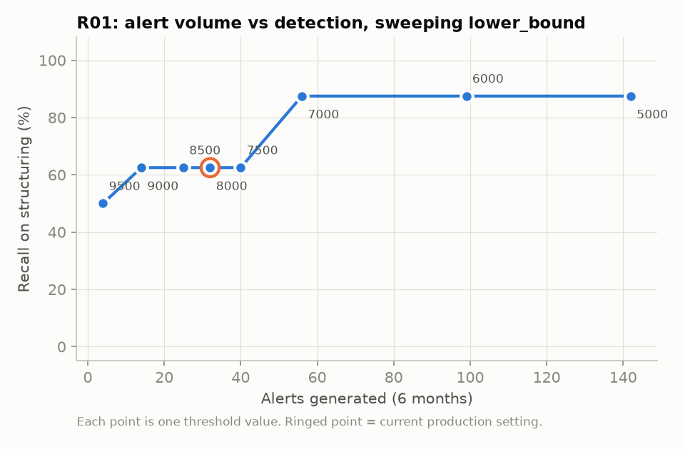
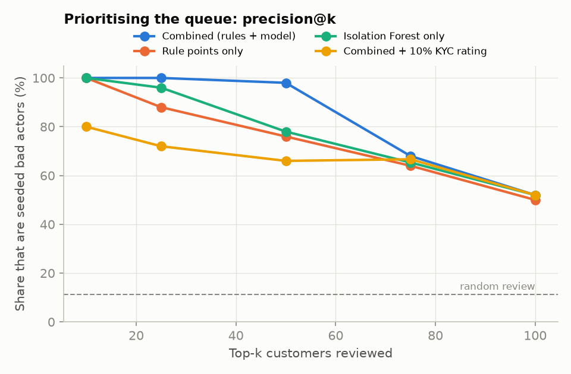

# 03 · Transaction Monitoring Simulator

**A working AML transaction monitoring pipeline built from scratch: synthetic bank data with hidden money-laundering typologies, a rules engine with tunable thresholds, an anomaly-detection second line, measured precision and recall, an analyst workbench, and 10 worked alert dispositions.**

> ⚠️ **All data is synthetic.** "Meridian Harbor Bank", its 500 customers and 57,986 transactions are randomly generated. No real people, accounts or institutions are represented. Legal and regulatory references are summarised for study purposes.



---

## What this project shows

| Analyst skill | Where it shows up |
|---|---|
| Knowing the typologies and their red flags | 8 typologies seeded into the data, each with a matching detection rule ([`src/rules.py`](src/rules.py)) |
| Understanding why false positives happen | Realistic legitimate lookalikes (cash businesses, home purchases, family remittances, importers) generate the noise |
| Threshold tuning and the volume-vs-detection trade-off | Parameter sweeps, plus program-wide presets, with charts |
| Going beyond rules | Isolation Forest on 15 behaviour features per customer, and a combined risk score that orders the queue |
| L1 alert review | Streamlit workbench: open an alert, read the KYC profile and the timeline, record a disposition with an audit trail |
| Writing defensible decisions | [10 worked dispositions](dispositions/README.md): 5 closed with rationale, 5 escalated |
| Regulatory knowledge | [`HOW_IT_WORKS.md`](HOW_IT_WORKS.md): BSA, CTR vs SAR, 31 U.S.C. 5324, workflow, interview Q&A |

## Results (production thresholds)

| Metric | Value |
|---|---|
| Customers / transactions / months | 500 / 57,986 / 6 (Jan to Jun 2026) |
| Seeded bad actors | 56 across 8 typologies (structuring, rapid movement, funnel, high-risk geography, round-dollar, dormant reactivation, TBML, mule network) |
| Alerts generated | **869** on 185 customers (about 7 per business day) |
| Alert precision | **60%**. Inflated: about 11% of customers are bad actors here, against well under 1% in a real bank |
| Customer recall | **98%** (55 of 56). The one miss is a "low and slow" structurer depositing about $1–2K at a time |
| Isolation Forest (unsupervised) | ROC AUC **0.97**. Flags 50 customers at 78% precision |
| Precision of top-50 queue | Rules only **76%**, model only **78%**, **combined 98%** |

**Per rule** (full table in [`outputs/evaluation_report.md`](outputs/evaluation_report.md)):

| Rule | Scenario | Alerts | Precision | Recall on its typology |
|---|---|---|---|---|
| R01 | Structuring (cash $8K to $10K) | 32 | 56% | 63%: misses structurers who stay under $8K |
| R02 | Rapid movement / pass-through | 263 | 36% | 100%: the noisiest rule (home closings, importers) |
| R03 | Funnel account (out-of-state cash) | 36 | 100% | 100% |
| R04 | High-risk jurisdictions (FATF lists, evasion corridors) | 129 | 80% | 100% |
| R05 | Round-dollar wires | 56 | 45% | 100% |
| R06 | Dormant account reactivation | 11 | 55% | 100% |
| R07 | Trade-based ML invoice pattern | 51 | 49% | 100% |
| R08 | Money mule (many senders, fast outflow, plus a secondary signal) | 30 | 93% | 100% |
| R09 | Activity far above the KYC profile (catch-all) | 248 | 72% | 84% (all typologies) |
| R10 | Device shared by 3 or more customers | 13 | 77% | 100% (mules) |

### Threshold tuning: the core trade-off
| Preset | Alerts | Precision | Bad actors caught |
|---|---|---|---|
| Aggressive | 1,602 | 39% | 98% |
| **Baseline** | **869** | **60%** | **98%** |
| Conservative | 474 | 83% | 95% (3 missed) |

Going aggressive nearly doubles the workload **without catching anyone new**. Going conservative halves it, but misses three bad actors. Single-parameter sweeps (for example R01's lower bound below) show where each rule's useful range is.

<p float="left">


</p>

Two findings worth discussing:
1. **R01 at $8K misses "smart" structurers who keep deposits around $5K to $7.5K.** Lowering the bound to $7,000 raises recall from 63% to 88% for 75% more R01 alerts (56 vs 32). Going down to $6,000 triples the alerts and catches no one extra. The catch-all R09 still caught most of them, which is why layered rules matter.
2. **Adding the static KYC risk rating to the queue ranking made it worse** (top-50 precision fell from 98% to 70%). Bad actors are usually onboarded as "low risk". Behaviour beats profile.

---

## How to run

```bash
cd 03-transaction-monitoring
python3 -m venv .venv && source .venv/bin/activate
pip install -r requirements.txt

python src/run_pipeline.py            # generate data → rules → model → scores → evaluation (~30s)
streamlit run app/analyst_app.py      # open the analyst workbench at http://localhost:8501
```

To experiment, edit a number in [`config/thresholds.json`](config/thresholds.json), then run `python src/run_pipeline.py --no-regen` and compare `outputs/evaluation_report.md`.

The generator is seeded (`SEED = 42`), so every run gives identical data and alert IDs. The worked dispositions refer to those IDs.

## Project layout

```
03-transaction-monitoring/
├── README.md                    ← you are here
├── HOW_IT_WORKS.md              ← interview prep: BSA, CTR vs SAR, 31 USC 5324, workflow, Q&A
├── config/thresholds.json       ← every rule parameter + anomaly model + score weights
├── src/
│   ├── generate_data.py         ← synthetic KYC + transactions + hidden typology labels
│   ├── reference.py             ← FATF black/grey lists, evasion corridors, free-zone markers
│   ├── rules.py                 ← 10 detection scenarios → alerts (customer × rule × month)
│   ├── anomaly.py               ← 15 behaviour features, Isolation Forest, combined risk score
│   ├── evaluate.py              ← precision/recall vs ground truth, tuning sweeps, charts, report
│   └── run_pipeline.py          ← end-to-end runner
├── app/analyst_app.py           ← Streamlit L1 workbench with disposition log
├── data/                        ← generated CSVs (ground_truth_* files are hidden from detection)
├── outputs/                     ← alerts.csv, risk scores, metrics.json, evaluation_report.md, charts/
└── dispositions/                ← 10 worked L1 alert dispositions
```

## Design choices (and why)

- **Ground truth is kept separate.** Rules and the model read only `customers.csv` and `transactions.csv`. The `ground_truth_*` files are used only after detection, to score results, the same way a bank judges alerts after investigation.
- **The noise is realistic.** About 20% of legitimate customers have a one-off "life event" after onboarding (an overseas wedding or medical bill, a car trade-in, an inheritance, a private car sale paid in cash, a loan payoff). Cash businesses deposit amounts that naturally fall in the $8K to $10K band. Households share devices. These produce the false positives an analyst has to clear.
- **Bad actors vary in sophistication.** Two structurers stay below $8K, and one actor per typology moves 80% smaller amounts. Some are therefore caught only by the catch-all rule, or caught for the "wrong" reason, which the report tracks separately (`caught_by_designed_rule`).
- **Alerts are grouped per customer, rule and month.** This matches how vendor systems batch alerts for an L1 queue. Precision and recall are measured per customer, because the investigator reviews the whole relationship.
- **The KYC profile is used inside the rules,** for example R04 suppresses countries declared at onboarding and R07 compares invoiced goods with the declared line of business. That is how real programs reduce false positives without lowering thresholds.

## Limitations
- The population is enriched with bad actors (11%), so absolute precision is optimistic. Compare *relative* numbers between settings.
- There are no real external checks (sanctions screening, negative news, CTR filings, RFIs). The dispositions mark these as *[simulated]*.
- The FATF lists are an illustrative snapshot. See [`src/reference.py`](src/reference.py).
- A single 6-month window: no seasonality, no continuing-activity reviews.

## Related
- [`04-sar-narratives`](../04-sar-narratives/): SARs written from alerts ALT-00153 (structuring) and ALT-00256 (mule network) in this project.
