# Evaluation report (auto-generated)

> Synthetic data. Generated by `src/run_pipeline.py`. Do not edit by hand; rerun the pipeline.

## Headline

- **500** customers, **57,986** transactions, **56** seeded bad actors.
- Production thresholds produced **869** alerts on **185** customers.
- Alert precision **60%** (524 alerts were on bad actors); **130** legitimate customers were alerted at least once.
- Customer recall **98%**: share of bad actors with at least one alert.
- Workload: about **7.0** alerts per business day over the 6 months.

Why precision looks high: this population is *enriched*. About 11% of customers are bad actors; in a real bank it is well under 1%, so real alert precision is often in the single digits. The relative comparisons between thresholds are the useful part.

## Per-rule performance

`target_recall` = share of the customers seeded with the typology the rule was designed for who got at least one alert from that rule.

| rule_id | rule | alerts | true_positive_alerts | precision | customers_alerted | target_typology | target_recall |
|---|---|---|---|---|---|---|---|
| R01 | Structuring: cash deposits just below the $10K CTR threshold | 32 | 18 | 0.56 | 15 | structuring | 0.62 |
| R02 | Rapid movement of funds (pass-through) | 263 | 95 | 0.36 | 111 | rapid_movement | 1.00 |
| R03 | Funnel account: cash deposited in multiple out-of-area states | 36 | 36 | 1.00 | 6 | funnel | 1.00 |
| R04 | Wires to/from high-risk jurisdictions | 129 | 103 | 0.80 | 57 | high_risk_geo | 1.00 |
| R05 | Repeated round-dollar wires | 56 | 25 | 0.45 | 28 | round_dollar | 1.00 |
| R06 | Dormant account reactivation | 11 | 6 | 0.55 | 11 | dormant_reactivation | 1.00 |
| R07 | Trade-based ML: invoice-pattern wires | 51 | 25 | 0.49 | 15 | tbml | 1.00 |
| R08 | Money mule activity (many senders, fast outflow) | 30 | 28 | 0.93 | 12 | mule_network | 1.00 |
| R09 | Activity far above KYC expected profile | 248 | 178 | 0.72 | 115 | (all typologies) | 0.84 |
| R10 | Device shared by multiple unrelated customers | 13 | 10 | 0.77 | 13 | mule_network | 1.00 |

## Detection by typology

| typology | customers | caught_by_any_rule | caught_by_designed_rule | flagged_by_isolation_forest | caught_by_rules_or_model |
|---|---|---|---|---|---|
| dormant_reactivation | 6 | 6 | 6 | 6 | 6 |
| funnel | 6 | 6 | 6 | 6 | 6 |
| high_risk_geo | 7 | 7 | 7 | 1 | 7 |
| mule_network | 10 | 10 | 10 | 10 | 10 |
| rapid_movement | 7 | 7 | 7 | 6 | 7 |
| round_dollar | 6 | 6 | 6 | 5 | 6 |
| structuring | 8 | 7 | 5 | 5 | 7 |
| tbml | 6 | 6 | 6 | 0 | 6 |

Customers caught by a rule *other than* the designed one were caught for the wrong reason. That still counts at customer level (the investigator reviews the whole relationship), but it is luck, not design.

## Second line: Isolation Forest

- ROC AUC **0.968**, average precision **0.861** (random = 0.11).
- At contamination 0.1: flags **50** customers, precision **78%**, recall **70%**.
- Bad actors flagged by the model but missed by every rule: **0** ; legitimate customers flagged only by the model: **3**.

| contamination | flagged | precision | recall |
|---|---|---|---|
| 0.02 | 10 | 1.00 | 0.18 |
| 0.05 | 25 | 0.96 | 0.43 |
| 0.08 | 40 | 0.90 | 0.64 |
| 0.10 | 50 | 0.78 | 0.70 |
| 0.15 | 75 | 0.65 | 0.88 |
| 0.20 | 100 | 0.52 | 0.93 |
| 0.30 | 150 | 0.36 | 0.96 |

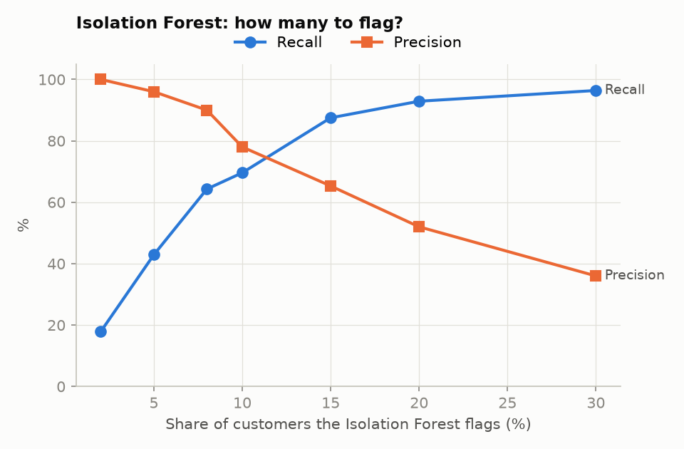

## Prioritising the queue (precision@k)

If an analyst team can only work the top k customers, how many are real? Combined score = 0.5 x rule-points percentile + 0.5 x anomaly percentile + 0.0 x KYC risk.

| k | combined_score | rules_only | anomaly_only | combined_plus_10pct_kyc | base_rate |
|---|---|---|---|---|---|
| 10 | 1.00 | 1.00 | 1.00 | 0.80 | 0.11 |
| 25 | 1.00 | 0.88 | 0.96 | 0.72 | 0.11 |
| 50 | 0.98 | 0.76 | 0.78 | 0.66 | 0.11 |
| 75 | 0.68 | 0.64 | 0.65 | 0.67 | 0.11 |
| 100 | 0.52 | 0.50 | 0.52 | 0.52 | 0.11 |

Adding the static KYC risk rating *lowers* precision here: the rating describes exposure (cash-intensive business, import/export, foreign nationality), and most seeded bad actors were onboarded as ordinary low-risk individuals. Behaviour beats profile for ranking alerts; the rating still matters for EDD and review frequency.

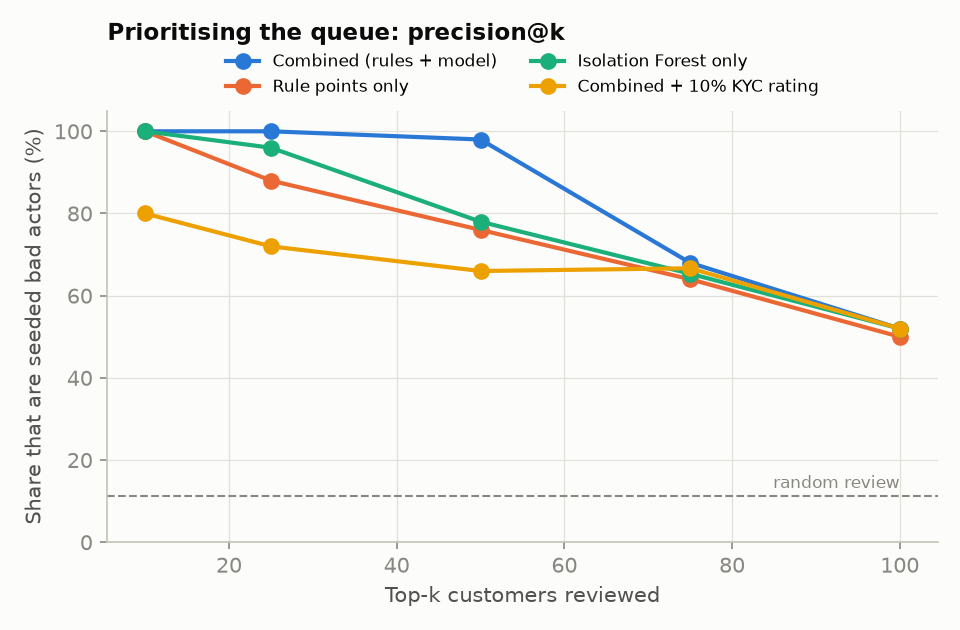

## Threshold tuning

### Program-wide presets

| preset | alerts | alert_precision | customer_recall | missed_bad_actors | of_which_isolation_forest_flags |
|---|---|---|---|---|---|
| aggressive | 1602 | 0.39 | 0.98 | 1 | 0 |
| baseline | 869 | 0.60 | 0.98 | 1 | 0 |
| conservative | 474 | 0.83 | 0.95 | 3 | 0 |

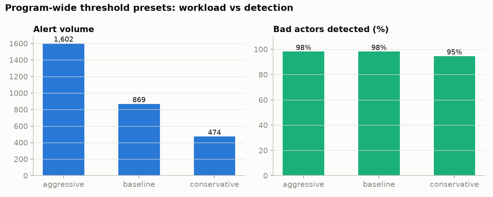

### Single-parameter sweeps

| rule_id | parameter | value | alerts | true_positive_alerts | false_positive_alerts | precision | target_recall |
|---|---|---|---|---|---|---|---|
| R01 | lower_bound | 5000 | 142 | 49 | 93 | 0.34 | 0.88 |
| R01 | lower_bound | 6000 | 99 | 34 | 65 | 0.34 | 0.88 |
| R01 | lower_bound | 7000 | 56 | 21 | 35 | 0.38 | 0.88 |
| R01 | lower_bound | 7500 | 40 | 18 | 22 | 0.45 | 0.62 |
| R01 | lower_bound | 8000 | 32 | 18 | 14 | 0.56 | 0.62 |
| R01 | lower_bound | 8500 | 25 | 15 | 10 | 0.60 | 0.62 |
| R01 | lower_bound | 9000 | 14 | 9 | 5 | 0.64 | 0.62 |
| R01 | lower_bound | 9500 | 4 | 4 | 0 | 1.00 | 0.50 |
| R02 | pass_through_ratio | 0.5 | 285 | 98 | 187 | 0.34 | 1.00 |
| R02 | pass_through_ratio | 0.6 | 275 | 98 | 177 | 0.36 | 1.00 |
| R02 | pass_through_ratio | 0.7 | 268 | 97 | 171 | 0.36 | 1.00 |
| R02 | pass_through_ratio | 0.8 | 263 | 95 | 168 | 0.36 | 1.00 |
| R02 | pass_through_ratio | 0.9 | 258 | 91 | 167 | 0.35 | 1.00 |
| R02 | pass_through_ratio | 0.95 | 229 | 78 | 151 | 0.34 | 0.71 |
| R02 | min_inflow | 10000 | 374 | 112 | 262 | 0.30 | 1.00 |
| R02 | min_inflow | 15000 | 302 | 105 | 197 | 0.35 | 1.00 |
| R02 | min_inflow | 20000 | 263 | 95 | 168 | 0.36 | 1.00 |
| R02 | min_inflow | 30000 | 137 | 71 | 66 | 0.52 | 0.86 |
| R02 | min_inflow | 50000 | 64 | 48 | 16 | 0.75 | 0.86 |
| R02 | min_inflow | 75000 | 39 | 23 | 16 | 0.59 | 0.86 |
| R04 | suppress_if_country_in_kyc_profile | False | 237 | 111 | 126 | 0.47 | 1.00 |
| R04 | suppress_if_country_in_kyc_profile | True | 129 | 103 | 26 | 0.80 | 1.00 |
| R05 | min_count_per_month | 1 | 155 | 30 | 125 | 0.19 | 1.00 |
| R05 | min_count_per_month | 2 | 56 | 25 | 31 | 0.45 | 1.00 |
| R05 | min_count_per_month | 3 | 20 | 14 | 6 | 0.70 | 0.83 |
| R05 | min_count_per_month | 4 | 16 | 14 | 2 | 0.88 | 0.83 |
| R07 | min_conditions | 1 | 153 | 33 | 120 | 0.22 | 1.00 |
| R07 | min_conditions | 2 | 51 | 25 | 26 | 0.49 | 1.00 |
| R07 | min_conditions | 3 | 6 | 6 | 0 | 1.00 | 0.50 |
| R08 | min_unique_senders | 4 | 40 | 30 | 10 | 0.75 | 1.00 |
| R08 | min_unique_senders | 6 | 31 | 28 | 3 | 0.90 | 1.00 |
| R08 | min_unique_senders | 8 | 31 | 28 | 3 | 0.90 | 1.00 |
| R08 | min_unique_senders | 10 | 30 | 28 | 2 | 0.93 | 1.00 |
| R08 | min_unique_senders | 15 | 28 | 28 | 0 | 1.00 | 1.00 |
| R08 | min_unique_senders | 20 | 22 | 22 | 0 | 1.00 | 1.00 |
| R08 | min_unique_senders | 30 | 16 | 16 | 0 | 1.00 | 0.70 |
| R08 | require_secondary_indicator | False | 149 | 41 | 108 | 0.28 | 1.00 |
| R08 | require_secondary_indicator | True | 30 | 28 | 2 | 0.93 | 1.00 |
| R09 | volume_multiplier | 1.5 | 293 | 198 | 95 | 0.68 | 0.93 |
| R09 | volume_multiplier | 2.0 | 267 | 187 | 80 | 0.70 | 0.88 |
| R09 | volume_multiplier | 3.0 | 248 | 178 | 70 | 0.72 | 0.84 |
| R09 | volume_multiplier | 4.0 | 220 | 170 | 50 | 0.77 | 0.82 |
| R09 | volume_multiplier | 6.0 | 177 | 151 | 26 | 0.85 | 0.71 |
| R09 | volume_multiplier | 10.0 | 135 | 121 | 14 | 0.90 | 0.66 |
| R10 | min_customers_per_device | 2 | 37 | 10 | 27 | 0.27 | 1.00 |
| R10 | min_customers_per_device | 3 | 13 | 10 | 3 | 0.77 | 1.00 |
| R10 | min_customers_per_device | 4 | 4 | 4 | 0 | 1.00 | 0.40 |

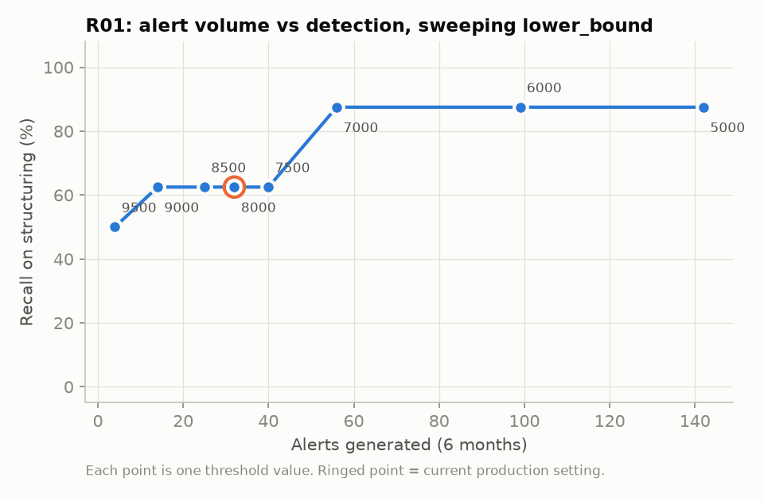

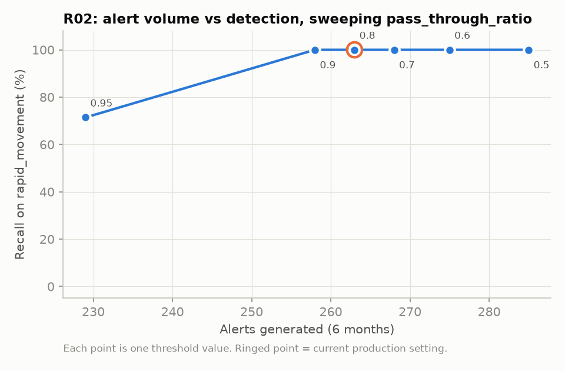

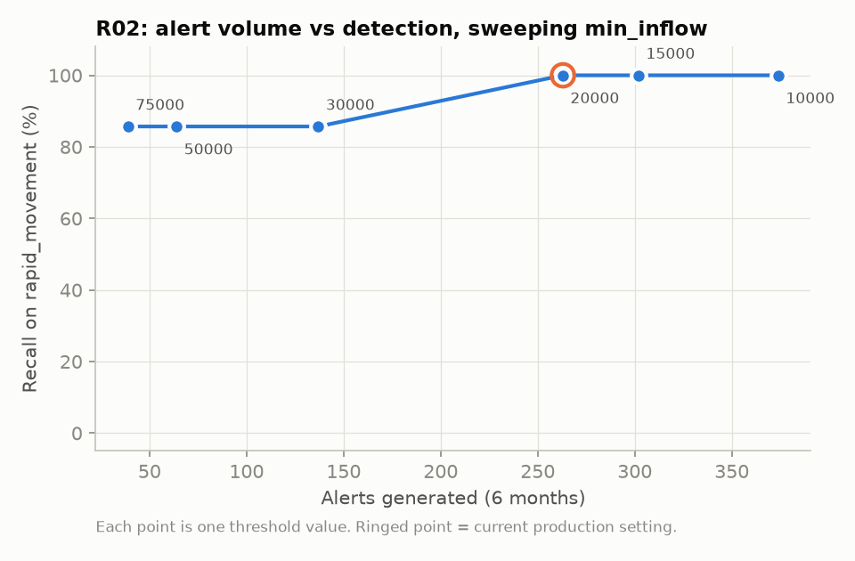

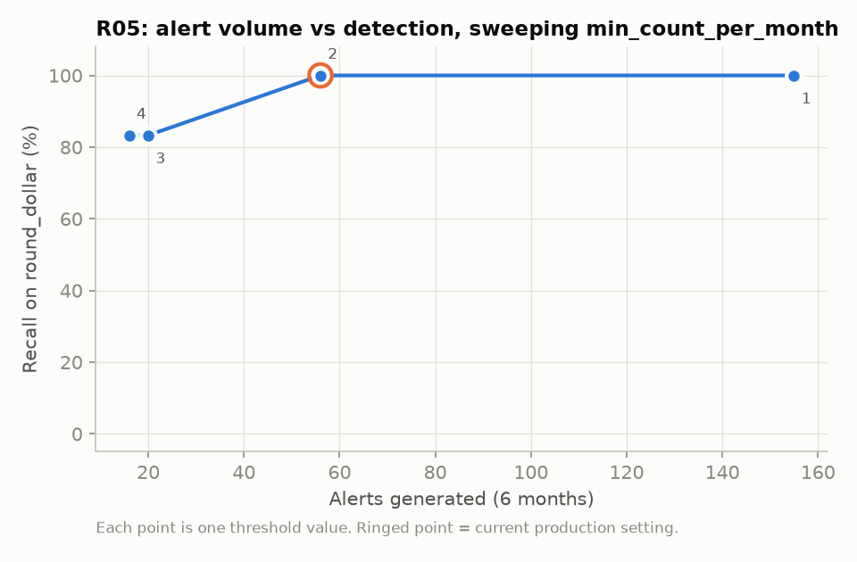

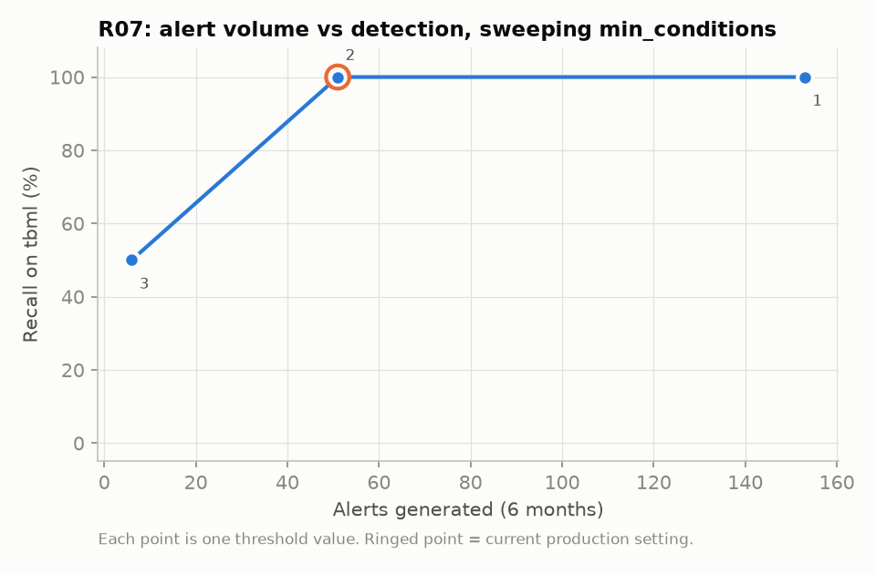

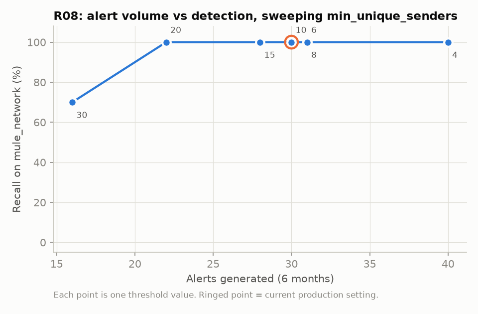

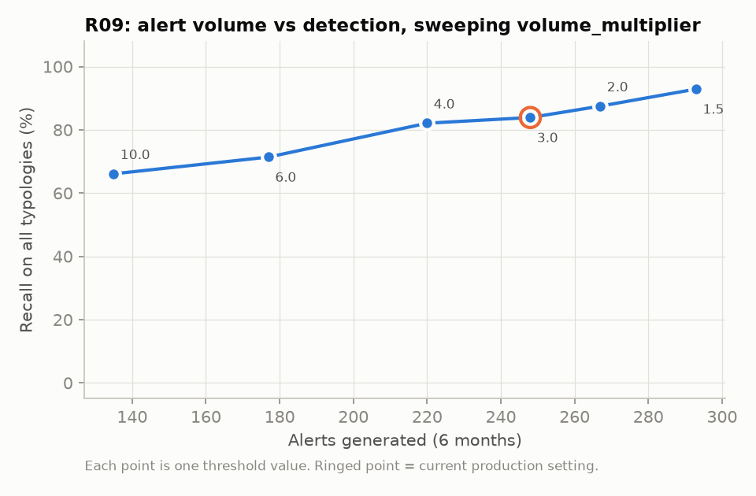

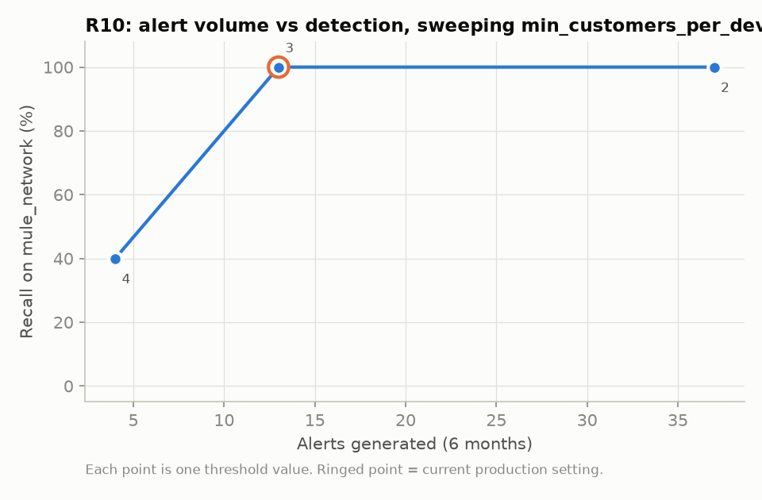
