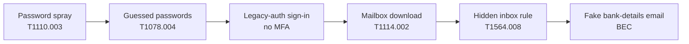

# 08 · Threat Hunt: Password Spray to Business Email Compromise

A full threat hunt on Microsoft Entra ID and Microsoft 365 logs. It catches a slow password spray, finds the accounts that fell, and traces one of them to an invoice-fraud (BEC) attempt. It ends with a customer-ready incident report.

**Read the report first:** [REPORT.md](REPORT.md)



## What's here

| Path | What it is |
|---|---|
| `generate_logs.py` | Builds 14 days of synthetic `SigninLogs` and `OfficeActivity` for a fictional 270-person company, with one attack planted inside (plus look-alikes: real travelers, typos, a harmless inbox rule) |
| `kql/` | Five hunts in KQL, ready to paste into Microsoft Sentinel |
| `hunt.py` | The same five hunts in Python/pandas, so it runs anywhere; scores results against the answer key |
| `sigma/` | Two portable detection rules (password spray, money-hiding inbox rule) |
| `findings/` | Output of each hunt |
| `REPORT.md` | Incident report: bottom line, timeline, scope, remediation, ATT&CK mapping, IOCs |

## Results

- 5/5 spray IPs found, 3/3 accounts with guessed passwords, the BEC account identified
- 0 false positives: three legitimate overseas travelers and a normal inbox rule were correctly left alone
- Root cause: one finance user's old ActiveSync client could not do MFA

## Run it

```bash
pip install pandas
python generate_logs.py   # writes data/
python hunt.py            # runs the 5 hunts, writes findings/, prints the score
```

## Key ideas

- **Spray ≠ brute force.** Brute force means many tries on one account. A spray is one or two tries on hundreds of accounts, which stays under lockout limits. So count *distinct accounts per IP*, not *failures per account*.
- **ResultType codes:** `0` success · `50126` bad password · `50074` password right but MFA required (the password is still compromised).
- **Legacy auth** (ActiveSync, IMAP, POP) can't do MFA, so one guessed password is enough.
- **BEC tell:** a new inbox rule that hides mail about invoices or payments, made from the same foreign IP minutes after sign-in.

*All data is synthetic; names, domains and IPs (reserved test ranges) are fictional.*
