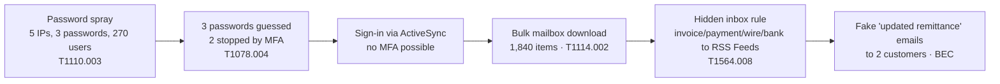

# Incident Report: Password Spray to Business Email Compromise

**Customer:** Contoso Freight (fictional) · **Environment:** Microsoft Entra ID + Microsoft 365
**Analyst:** H. Michael Bourenane · **Report date:** November 19, 2026 · **Severity:** High
**Data:** 14 days of synthetic sign-in and mailbox audit logs (7,975 sign-ins, 4,458 mailbox events, 270 users)

> Training exercise. The company, people, domains and IP addresses are all invented (IPs come from reserved test ranges). The scenario is modeled on the publicly reported password-spray campaigns against Microsoft 365 tenants and the business email compromise pattern that often follows them.

---

## 1. Bottom line

- On **November 11, 2026**, an attacker ran a slow password spray against every account in the tenant from **5 rented IP addresses** in the Netherlands and Germany.
- The attacker guessed the passwords of **3 accounts**. MFA stopped two of them. The third, **marco.reyes (Finance)**, still had an old **Exchange ActiveSync** mail client that does not support MFA, so the attacker got in with the password alone.
- Within 31 minutes the attacker downloaded the mailbox, **created a hidden inbox rule** to bury replies about payments, and **emailed two customers "updated bank details"**, the classic invoice-fraud setup.
- **No evidence** of access to other mailboxes, SharePoint, or admin roles in the data reviewed.
- **Act now:** contact the two customers by phone before they pay, reset the three passwords, and block legacy authentication tenant-wide.

## 2. Attack chain

## 3. Timeline (UTC)

| Time | Event | Evidence |
|---|---|---|
| Nov 11 01:00 | Spray starts: one wrong-password attempt per account, rotating across 5 IPs, about one try every 7 seconds | Hunt 1 |
| 01:00–06:42 | Three rounds (three passwords), with about 2-hour pauses so no account hits the lockout threshold | Hunt 1 |
| 06:13 | Password correct for **sam.kim** (from 198.18.44.11) | Hunt 2 |
| 06:31 | Password correct for **marco.reyes** (from 198.18.91.40) | Hunt 2 |
| 06:42 | Password correct for **lena.lopez** (from 198.18.44.11) | Hunt 2 |
| 08:57 | Attacker tries the web sign-in for sam.kim and lena.lopez. **MFA blocks both** (ResultType 50074) | Hunt 2 |
| 09:22 | Attacker signs in as **marco.reyes** over Exchange ActiveSync from 198.18.44.12 (NL), single-factor | Hunts 3, 5 |
| 09:25 | 1,840 mailbox items accessed (bulk sync) | Hunt 5 |
| 09:31 | Inbox rule named "." created: messages containing invoice, payment, wire or bank go to *RSS Feeds*, marked read | Hunt 4 |
| 09:53 | Email to ap@harborlogistics.example: "Updated remittance details – Contoso Freight" | Hunt 5 |
| 14:22 | Same email to billing@pacifictrade.example | Hunt 5 |

## 4. How it was found

Each hunt is written in **KQL** for Microsoft Sentinel (`kql/`) and mirrored in **Python** (`hunt.py`) so it can run without a Sentinel workspace.

| # | Hunt | Logic | Result |
|---|---|---|---|
| 1 | Password spray | One IP failing (ResultType 50126) against 20+ different accounts | 5 IPs, 114–138 accounts each, about 1.2 tries per account, all with the `python-requests` user agent |
| 2 | Spray success | Any success (0) or "MFA required" (50074) from those IPs | 3 accounts with guessed passwords |
| 3 | Legacy auth | Successful single-factor sign-ins over ActiveSync/IMAP/POP | 4 sign-ins, all from the spray IPs |
| 4 | Inbox rules | Rules mentioning money words, obscure folders, or blank names | 1 rule (marco.reyes). A real "Newsletters" rule was *not* flagged |
| 5 | BEC chain | Foreign sign-in, then mailbox actions from the same IP within 6 hours | 1 account. Three real travelers (London, Toronto, Mexico City) were *not* flagged |

**Score against the answer key:** 5/5 spray IPs, 3/3 compromised accounts, BEC account found, **0 false positives**.

**Why a simple brute-force alert would have missed it:** no account saw more than 3 failures, so lockout never triggered. The pattern only shows up when you count *accounts per IP* instead of *failures per account*.

## 5. Scope

| Account | Password known to attacker | Attacker got in? | Action |
|---|---|---|---|
| marco.reyes | Yes | **Yes**, via ActiveSync, no MFA | Full remediation (below) |
| sam.kim | Yes | No, MFA blocked | Reset password |
| lena.lopez | Yes | No, MFA blocked | Reset password |
| Other 267 users | No (one wrong guess each) | No | Watch for repeat sprays |

## 6. Remediation

**Contain (today)**
1. **Phone** Harbor Logistics and Pacific Trade on a number you already have on file (not one from the email) and tell them to ignore the "updated remittance details" emails.
2. Disable marco.reyes's sign-in, **revoke all sessions and refresh tokens**, then reset the password.
3. Delete the inbox rule named "." and check the RSS Feeds folder for hidden customer replies.
4. Reset passwords for sam.kim and lena.lopez.
5. Block the five spray IPs (short-term only; the attacker will rotate).

**Fix the root cause (this week)**
6. **Block legacy authentication** (ActiveSync basic auth, IMAP, POP) with a Conditional Access policy. This is the single gap that turned a guessed password into a breach.
7. Turn on **Entra ID Password Protection** with a custom banned-password list (company name, city, seasons plus year).
8. Require phishing-resistant MFA (passkeys or FIDO2) for Finance and admins.
9. Alert on new inbox rules that forward mail or move it to unusual folders (Sigma rule in `sigma/`).

**Detect next time**
10. Deploy Hunt 1 as a scheduled Sentinel analytic rule (every hour, 6-hour lookback).
11. Deploy Hunt 5 as an analytic rule for Finance and executive accounts.

## 7. MITRE ATT&CK mapping

| Tactic | Technique | Observed |
|---|---|---|
| Credential Access | T1110.003 Password Spraying | 5 IPs × 3 passwords × 270 users |
| Initial Access / Persistence | T1078.004 Valid Accounts: Cloud Accounts | Sign-in as marco.reyes with a guessed password |
| Collection | T1114.002 Remote Email Collection | 1,840 items synced over ActiveSync |
| Defense Evasion | T1564.008 Email Hiding Rules | Rule "." to RSS Feeds, marked read |
| Impact / Financial theft | T1657 Financial Theft | Fake bank-detail emails to 2 customers |

## 8. Indicators

| Type | Value | Note |
|---|---|---|
| IP | 198.18.44.11, .12, .13 | Spray + takeover (NL) |
| IP | 198.18.91.40, .41 | Spray (DE) |
| User agent | python-requests/2.31 | Scripted sign-ins |
| Inbox rule | Name "." → RSS Feeds | Hides payment replies |
| Email subject | "Updated remittance details – Contoso Freight" | BEC lure |
